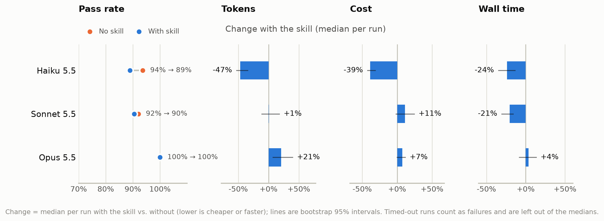
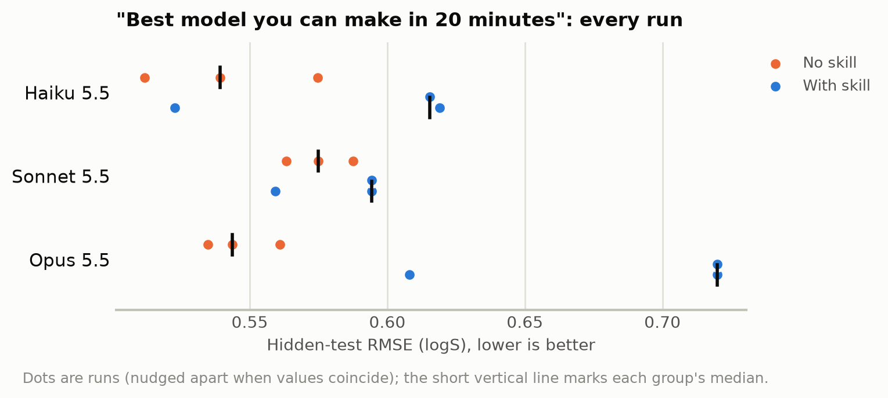

# Does an Agent Skill make coding agents better at Chemprop?

We wrote an [Agent Skill](https://agentskills.io) for [Chemprop](https://github.com/chemprop/chemprop)
and measured what it does for AI coding agents. The skill is a short `SKILL.md` plus reference
files, shipped inside the Chemprop package. We ran Claude Code on 21 Chemprop tasks, with and
without the skill, on three Claude models, and graded every run against hidden test labels.

**Short answer:**
- **The smallest model gets much cheaper.** Haiku uses about half the tokens, 39% less money and
  24% less time per run. Its pass rate drops by 3 runs out of 63 (94% → 89%), within the
  run-to-run noise of these tasks.
- **The stronger models already solve these tasks without help.** For Sonnet the skill saves
  about a fifth of the wall time at a modest cost; for Opus it adds a little cost and changes
  little else.
- **A skill also steers.** Advice that is right in general can still lead agents to a worse model
  on a particular dataset (see [What the skill changed](#what-the-skill-changed)).

<picture>
  <source media="(prefers-color-scheme: dark)" srcset="results/2026-10-21-final/figures/headline_dark.png">
  
</picture>

## Results

Final round: 21 tasks × 2 arms × 3 runs × 3 models = 378 runs, $53.20 API-equivalent.

| Model | Pass rate | Median tokens per run | Median cost per run | Median wall time per run |
|---|---|---|---|---|
| Haiku 5.5 | 59/63 → 56/63 (94% → 89%) | 495k → 263k (**−47%**) | $0.019 → $0.011 (**−39%**) | 147 s → 112 s (**−24%**) |
| Sonnet 5.5 | 58/63 → 57/63 (92% → 90%) | 121k → 122k (**+1%**) | $0.092 → $0.102 (**+11%**) | 69 s → 55 s (**−21%**) |
| Opus 5.5 | 63/63 → 63/63 (100% → 100%) | 173k → 209k (**+21%**) | $0.275 → $0.295 (**+7%**) | 103 s → 107 s (**+4%**) |

Each cell reads "without the skill → with the skill".

- **Costs are API-equivalent estimates.** They are Claude Code's own figures; on a subscription
  they measure usage, not a bill.
- **Timeouts:** 2 runs (both Sonnet, one per arm) timed out. They count as failures and are left
  out of the medians, because Claude Code reports usage only when a session ends.
- **Refused tool calls:** 17 runs, all of which passed, had a tool call refused by the harness.
  These were reads of Chemprop's installed source; the repository checkout was readable.
  Excluding them gives the same picture (Haiku −47% tokens, Sonnet +3%, Opus +20%).
- **Skill use:** with the skill, agents used it in 182 of 189 runs. Sonnet and Opus used it every
  time; Haiku 56 of 63.
- **v1 commands:** no agent in either arm tried a v1 command.

<details>
<summary>Pass counts per task</summary>

Each cell gives runs passed without the skill → with the skill, out of 3.

| Task | Haiku 5.5 | Sonnet 5.5 | Opus 5.5 |
|---|---|---|---|
| `atom_charges_cli` | 3/3 → 3/3 | 3/3 → 0/3 | 3/3 → 3/3 |
| `atom_charges_py` | 3/3 → 2/3 | 3/3 → 3/3 | 3/3 → 3/3 |
| `attentive_aggregation_py` | 3/3 → 3/3 | 3/3 → 3/3 | 3/3 → 3/3 |
| `best_model` | 3/3 → 3/3 | 3/3 → 3/3 | 3/3 → 3/3 |
| `chemeleon_hourglass_cli` | 3/3 → 3/3 | 3/3 → 3/3 | 3/3 → 3/3 |
| `chemeleon_hourglass_py` | 3/3 → 3/3 | 2/3 → 3/3 | 3/3 → 3/3 |
| `chemeleon_reactions_cli` | 3/3 → 3/3 | 3/3 → 3/3 | 3/3 → 3/3 |
| `constrained_charges_cli` | 3/3 → 3/3 | 3/3 → 3/3 | 3/3 → 3/3 |
| `constrained_charges_py` | 3/3 → 3/3 | 3/3 → 3/3 | 3/3 → 3/3 |
| `cuik_reactions_cli` | 3/3 → 3/3 | 3/3 → 3/3 | 3/3 → 3/3 |
| `cuik_reactions_py` | 3/3 → 3/3 | 3/3 → 3/3 | 3/3 → 3/3 |
| `fix_buggy_script_py` | 3/3 → 3/3 | 3/3 → 3/3 | 3/3 → 3/3 |
| `marked_atom_cli` | 3/3 → 3/3 | 3/3 → 3/3 | 3/3 → 3/3 |
| `marked_atom_py` | 3/3 → 3/3 | 3/3 → 2/3 | 3/3 → 3/3 |
| `prediction_intervals_cli` | 2/3 → 0/3 | 3/3 → 2/3 | 3/3 → 3/3 |
| `prediction_intervals_py` | 3/3 → 3/3 | 3/3 → 3/3 | 3/3 → 3/3 |
| `rdkit_descriptors_cli` | 1/3 → 3/3 | 2/3 → 3/3 | 3/3 → 3/3 |
| `rdkit_descriptors_py` | 3/3 → 3/3 | 0/3 → 3/3 | 3/3 → 3/3 |
| `resonance_forms_cli` | 2/3 → 0/3 | 3/3 → 2/3 | 3/3 → 3/3 |
| `stereoisomers_cli` | 3/3 → 3/3 | 3/3 → 3/3 | 3/3 → 3/3 |
| `stereoisomers_py` | 3/3 → 3/3 | 3/3 → 3/3 | 3/3 → 3/3 |

</details>

Raw data, per run: [`results/2026-10-21-final/runs.jsonl`](results/2026-10-21-final/runs.jsonl)
(also [`runs.csv`](results/2026-10-21-final/runs.csv), and [`summary.md`](results/2026-10-21-final/summary.md),
which leaves out the 17 runs with a refused tool call that the table above includes).
The tables and figures are generated by [`scripts/report_tables.py`](scripts/report_tables.py) and
[`scripts/figures.py`](scripts/figures.py).

## What the skill changed

Most per-task differences are one run out of three, in both directions. The clear ones:

- **Descriptors as extra inputs** (`rdkit_descriptors`): the skill helped.
  - Sonnet's Python runs went from 0/3 to 3/3, and Haiku's CLI runs from 1/3 to 3/3.
  - Without the skill, Sonnet standard-scaled the raw RDKit 2D descriptors and got test RMSEs from
    2.8 to 286.
  - The skill warns that these descriptors are poorly served by standard scaling; a few extreme
    descriptor values likely explain the failures.
- **Per-atom charges** (`atom_charges_cli`, Sonnet 3/3 → 0/3): the skill hurt.
  - The skill's pitfalls section says the default random split gives an optimistic estimate, and
    suggests stricter splits.
  - All three Sonnet runs with the skill applied that to the model they delivered: they trained it
    on a k-means split, two of them with early stopping on that split's validation set.
  - Those models were worse: per-atom MAE 0.014, against 0.008 without the skill.
  - All three runs also fixed `--pytorch-seed 0` and got the same MAE to five decimals, so this
    is one recipe repeated, not three independent samples.
  - The advice is about *estimating* accuracy, but agents read it as a way to build a better model.
- **"The best model you can make in 20 minutes"** (`best_model`): every run passes the threshold,
  but the hidden-test error shows the steering effect.

<picture>
  <source media="(prefers-color-scheme: dark)" srcset="results/2026-10-21-final/figures/best_model_dark.png">
  
</picture>

What happened in `best_model`:

- **An earlier version of the skill said "for small datasets, start from the CheMeleon foundation
  model."** Opus and Sonnet then fine-tuned CheMeleon and stopped (hidden-test RMSE 0.71). Without
  the skill, they tried RDKit descriptors or a descriptor-based tree model, which do better on this
  solubility set (0.52–0.58).
- **The skill now says to compare CheMeleon with RDKit descriptors on the same split.** Opus does
  exactly that. CheMeleon wins its own validation (mean RMSE 0.59 against 0.68), so it picks
  CheMeleon, which still loses on the hidden test.
- **What this shows:** the agent's process is now sound; its random-split validation simply
  disagrees with the hidden test set. Haiku with the skill never opened the CheMeleon reference,
  so its spread is ordinary run-to-run variation.
- **Not an independent test:** because we revised this advice after seeing an earlier round,
  `best_model` no longer tests the skill independently.

## The skill

The skill lives in the Chemprop package at `chemprop/.agents/skills/chemprop/`. The version
measured here is frozen in [`skill_pr/`](skill_pr/), with checksums and its source in
`FROZEN_FROM.txt`.

| File | Lines | When the agent reads it |
|---|---|---|
| `SKILL.md` | 131 | whenever the skill is used: v1 vs. v2 commands, install, the train and predict recipes, pitfalls |
| `references/workflows.md` | 69 | when needed: CheMeleon, learned fingerprints, GPUs and multi-GPU training |
| `references/training.md` | 118 | task types, splits, ensembles, transfer learning, hyperparameter optimization |
| `references/inputs.md` | 120 | mixtures, reactions, extra features and descriptors, atom- and bond-level targets |
| `references/uncertainty.md` | 67 | uncertainty estimation and calibration |
| `references/python-api.md` | 215 | training and predicting from Python |
| `references/v1-to-v2.md` | 58 | migrating v1 commands, scripts and models |

**Why `SKILL.md` is short:**
- Its text stays in the agent's context and is re-read on every turn. Everything that only some
  tasks need is in reference files, which agents open on demand.
- An earlier round compared the longer `SKILL.md` ([`skill/`](skill/), 203 lines) with the short
  one ([`skill_short/`](skill_short/)). The short one cost less on the strong models and passed as
  often or more often.
- The measured version, [`skill_pr/`](skill_pr/), is the short one with the CheMeleon advice
  rewritten.

## The tasks

21 tasks, listed with their exact grading in [`tasks/round3/README.md`](tasks/round3/README.md).
Each prompt says Chemprop is installed, a checkout of the repository is in `./chemprop`, data is in
`./data`, there is no internet, and training runs are capped at 30 epochs. Where it makes sense, a
task has a command-line (`_cli`) and a Python API (`_py`) variant. The tasks:

- RDKit 2D descriptors as extra inputs, scaled appropriately.
- CheMeleon fine-tuning with a 512 → 128 → 512 feed-forward network.
- A learned-attention readout.
- 90% prediction intervals.
- cuik-molmaker featurization for reactions.
- Per-atom partial charges, also constrained to sum to each molecule's total charge.
- **A marked atom** (suggested by Nathan Morgan): one atom per molecule is marked only through a
  raw 0/1 bond feature.
- Identical predictions for all resonance forms, or for both stereoisomers, of a molecule.
- Fixing a training script with three silent bugs.
- The most accurate model possible in 20 minutes.
- Fine-tuning CheMeleon on reactions. This is impossible as asked, and the agent has to say so.

## How the runs are graded

- **Hidden labels:** predictions are compared row by row with test labels that never enter the
  agent's workspace. No test molecule appears anywhere in the workspace.
- **Thresholds from references:** pass thresholds come from reference solutions run with 5 seeds:
  the larger of mean + 2 SD and mean + 10%.
- **Model inspection:** saved models are loaded in a sandbox with no network, to check
  architecture claims such as the FFN shape, the aggregation, the CheMeleon weights, or the feature
  sizes. For the marked-atom task, the grader also re-runs the agent's model with its own bond
  features and the mark moved to another atom, so predictions can't be copied from the input.
- **The impossible task:** graded by a Claude Haiku judge with a fixed rubric, which reads the
  agent's last messages.
- **Validation:** every grader was run on a correct and a naive reference solution before use.
  Every correct one passes; every naive one fails for the intended reason.
- **Checking failures:** failures were inspected by hand. Harness problems were fixed and the runs
  re-graded; agent failures stand, as described in [Development history](#development-history).

## How the runs are isolated

**The two arms.** The arms differ only in the skill:

| | without the skill | with the skill |
|---|---|---|
| Chemprop installed (upstream `main`, no skill inside) | yes | yes |
| Repository checkout with docs, tutorials, notebooks and source in `./chemprop` | yes | yes |
| Task data in `./data` | yes | yes |
| The skill in `./.claude/skills/chemprop/` | no | yes |

The baseline is deliberately strong: the agent can read all of Chemprop's own documentation and
source. The arms are interleaved in time, so both see the same machine load and rate limits.

**The agent's sandbox.** Each run is a fresh, headless Claude Code session (`claude -p`):
- **Clean configuration:** user settings, plugins, hooks and MCP servers are off.
- **Hidden from other runs:** each run works in a randomly named directory under an unlistable
  parent, so runs without the skill cannot find the skill in another run.
- **Bash sandbox:** shell commands run in Claude Code's sandbox
  ([bubblewrap](https://github.com/containers/bubblewrap)). They can read only the run directory,
  the Python environment and the CheMeleon cache; they can write only to the run directory; and the
  network is blocked.
- **GPU tasks** run the whole Claude Code process in a separate bubblewrap box
  ([`scripts/box.py`](scripts/box.py)) that exposes only the run directory, system files, the
  Python environment and the GPU devices. Claude Code gets only a short-lived access token in this
  box, never the refresh token.

**Isolation checks.** Agents were asked to break out: read the user's files, list other runs, find
any `SKILL.md`, write elsewhere, and reach the internet. Every attempt failed, except internet
access inside the GPU box, which the box needs to reach the API.

## Development history

The final round above is the result we report. Earlier rounds shaped it:

- **Rounds 1–2 (16 tasks).** Every model passed close to 100% of these basic and pitfall tasks with
  or without the skill, so pass rates could not separate the arms. They showed the skill makes runs
  faster, and that a long `SKILL.md` costs Opus about 40% more tokens; the short one cost about 15%.
- **Round 3 (19 of the final 21 tasks).** This round compared the long and the short `SKILL.md`
  (pass counts out of 57):

  | Model | Pass, no skill → long → short | Tokens, long / short | Cost, long / short |
  |---|---|---|---|
  | Haiku | 53 → 52 → 50 | −48% / −45% | −33% / −29% |
  | Sonnet | 55 → 55 → 56 | +9% / +3% | +19% / +14% |
  | Opus | 56 → 56 → 57 | +19% / +15% | +9% / +5% |

  It also found the CheMeleon steering effect described above.
- **After round 3,** the skill switched to the short version, its CheMeleon advice was rewritten,
  and the marked-atom task was added.
- **Corrections made along the way:**
  - Graders that wrongly failed correct runs were fixed and all runs re-graded. For example, one
    check only read `run.sh` and missed a helper script it called, and the judge read only an
    agent's final postscript.
  - Runs lost to a full disk on the shared machine were re-run.
  - Each round's `NOTES.md` in [`results/`](results/) lists these corrections.

## Limitations

- **One agent, one model family:** Claude Code with Claude models only. Other agents (Codex,
  Copilot, Cursor) may use skills differently.
- **Small samples:** 3 runs per cell. Per-task differences of one run out of three are noise.
  Agents often fix `--pytorch-seed 0`, so repeats that pick the same recipe give the same result,
  and are less independent than three runs suggest.
- **One task set, written by the skill's authors.** The skill was revised once after an earlier
  round (the CheMeleon advice), so `best_model` is not an independent test.
- **Small hidden test sets** for some tasks (20 molecules or reactions), so those tasks lean on the
  architecture and featurization checks.
- **Limits stated, not enforced:** the 30-epoch cap and the 20-minute budget.
- **The hidden labels are published** in [`hidden/`](hidden/), so anyone can re-grade the runs.
  They are derived from Chemprop's public test data, and
  [`scripts/build_round3_data.py`](scripts/build_round3_data.py) rebuilds them byte for byte. A
  model trained on this repository could have seen them, so future re-runs should rebuild the test
  sets from new molecules.

## Reproducing

Requirements: Linux with `bubblewrap` and `socat`, conda, and Claude Code logged in.

```bash
conda env create -n chemprop_skill_eval -f <chemprop>/environment.yml
conda install -n chemprop_skill_eval -c conda-forge socat
<env>/bin/pip install --no-deps <chemprop checkout at the commit to test>

scripts/build_workspace.sh /path/to/chemprop origin/main          # .workspace/, then .workspace_r3/
cd scripts
python3 run_eval.py --name my-run --workspace .workspace_r3 --tasks-dir ../tasks/round3 \
    --models haiku sonnet claude-opus-5-5 --arms without with_pr --runs 3 --budget-usd 70
python3 report_tables.py ../results/my-run
<env>/bin/python figures.py ../results/my-run
```

`run_eval.py --help` lists every option: models, tasks, arms, repeats, a total budget, a per-run
budget, turn and time limits, concurrency, and a free-disk guard.

## License

MIT; see [`LICENSE`](LICENSE). The skill files are also MIT, like Chemprop.
